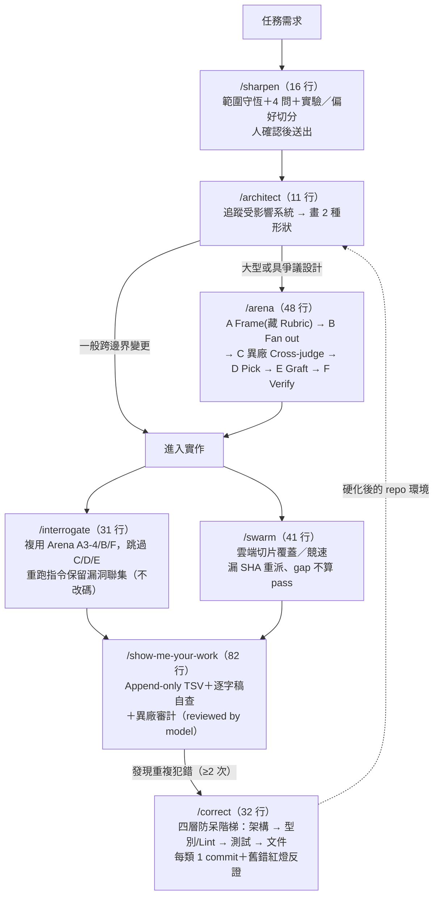

# pstack 核心 Skill 原始碼深度拆解：`/architect`、`/arena`、`/interrogate`、`/swarm`、`/correct`、`/show-me-your-work`

- 來源：
  - https://github.com/cursor/plugins/blob/main/pstack/skills/architect/SKILL.md
  - https://github.com/cursor/plugins/blob/main/pstack/skills/arena/SKILL.md
  - https://github.com/cursor/plugins/blob/main/pstack/skills/interrogate/SKILL.md
  - https://github.com/cursor/plugins/blob/main/pstack/skills/swarm/SKILL.md
  - https://github.com/cursor/plugins/blob/main/pstack/skills/correct/SKILL.md
  - https://github.com/cursor/plugins/blob/main/pstack/skills/show-me-your-work/SKILL.md
  - https://github.com/cursor/plugins/blob/main/pstack/docs/guide/04-design.md
- 收錄日期：2026-11-25
- 與本專案的關聯：pstack 六個核心設計、並行驗證與環境治理 skill 的官方原始碼結構、協作關係與影片口述差異對照筆記，屬學習筆記，與 OpenWiki 程式碼無直接關聯
- 備註：依據本地同步之 `cursor/plugins`（2026-11-20 快照）原始 `SKILL.md` 全文與官方指南整理；前置 `/sharpen` 獨立拆解詳見 [pstack-sharpen-deep-dive.md](./pstack-sharpen-deep-dive.md)，影片全景筆記見 [pstack-video-deep-dive.md](./pstack-video-deep-dive.md)。

## 七大核心 Skill 總覽對照表（完整流水線視角）

| Skill（行數） | 階段定位 | 核心目標 | 是否改碼 | 並行／跨模型機制 | 核心防作弊／防偏誤機制 | 影片口述 vs 原始碼最大差異 |
|---|---|---|---|---|---|---|
| **`/sharpen`**（16 行） | 動工前：Prompt 銳化 | 做深不做大（範圍守恆） | 否（回傳新 prompt） | 單模型 | ① 第 4 問限定 `other than you or me` 外部驗收 ② 可實驗選擇自測、偏好留給人 | 影片併為 3 點，漏講結尾「實驗 vs 偏好」決策切分 |
| **`/architect`**（11 行） | 動工前／實作中：定骨架 | 避免首個直覺鎖死錯誤結構 | 否（定型別／簽名／邊界） | 單模型畫 2 案；**大型／爭議設計才升級 `/arena`** | ① 強迫畫 **2 種形狀**（單一狀態擁有者／單一做法／呼叫端知最少） ② workaround 重複出現則重設計 | ① 影片說畫圖自動叫 `/arena`，實際為條件式升級 ② 「假設下個 AI 只看眼前檔案照抄」原話其實在 **`/correct`** 而非 `/architect` |
| **`/arena`**（48 行） | 設計／實作分歧：多模型合成 | 多路生成 → 選基底 → 手工嫁接 | 是（輸出單一合成產物） | **N 個平行 runner**（獨立 worktree）＋ **1 位異廠唯讀裁判** | ① **Rubric 隱藏**（候選者看不到評分表） ② 異廠 Cross-judge（寫死 `Fable counts as Claude`） ③ 劇烈發散不平均，直接重定題 | 影片未提 Rubric 資訊隔離與「劇烈發散重跑不平均」規則 |
| **`/interrogate`**（31 行） | 改完碼後：對抗式破防審查 | 專抓真實 bug／回歸，只留實證 | **否**（`Do not apply fixes`） | **複用 `/arena` Fan-out**（獨立 worktree 複製未提交變更） | ① **無實測指令佐證一律剔除**（禁評風格／命名／理論風險） ② 跳過 C/D/E，主控端重跑複驗取漏洞聯集 ③ 必列 `Dropped` 清單供人覆核 | 影片說「兩家同警＝真 bug」；原始碼標準是**重跑實證打爆 Intent**（單家抓到也算，沒跑指令全刪） |
| **`/swarm`**（41 行） | 驗證覆蓋／多路競速 | 切片全覆蓋或宣告規則競速 | 視任務（寫入時各自獨立輸出） | **N 個平行 worker**（預設 `environment: "cloud"`） | ① 強制記錄精確 SHA 與量測方法，漏記直接重派一次 ② 連漏記為 `gap`，**`gap` 絕不算 `PASS`** ③ 找到問題須列盡所有可證缺陷，不只第一個 | 影片窄化為過夜 10 個獨立 AI 點 App；實際上是通用分片覆蓋／競速引擎（與 `/arena` 互補，不做嫁接） |
| **`/show-me-your-work`**（82 行） | 長耗時／過夜審計 | 產出可稽核的決策帳本 | 否（寫入 TSV 帳本） | 結束前派**異廠模型**同時審 TSV＋對話逐字稿 | ① **Append-only TSV**（不准竄改刪歷史，錯了用新列 supersede） ② 結尾須對照 `agent-transcripts/` 核實證據指標 ③ `log.sh` 防公式注入；回覆結尾必寫 `reviewed by <model>` | 影片僅簡稱「決策紀錄表」；原始碼是含逐字稿自查、跨廠審計與防注入腳本的嚴格審計協議 |
| **`/correct`**（32 行） | 事後環境補強 | 讓重複錯誤從物理上不可能再犯 | 是（每類錯誤一筆 commit） | 單模型治理整個 repo（可搭 `/architect`） | ① **發生兩次即入類**，按「架構→型別/Lint/CI→測試→文件」四層由高到低修 ② 新檢查須在真實舊錯上先證明會亮紅燈 ③ 維護規則↔執行機制表，物理消除後刪規則 | 影片聚焦 Linter/CI 案例；原始碼還規定「棘輪策略（只攔新增）」、例外必帶「理由＋到期日＋人核准」與規則自我淘汰 |

> 七個 skill 全數都在 frontmatter 設定了 **`disable-model-invocation: true`**，防止模型在未授權時自行亂觸發，僅由人工顯式呼叫或 `/poteto-mode` 劇本依階梯調度。

## 七大 Skill 協作與架構重用關係

---

## 1. `/architect` 原始碼拆解（11 行）

1. **先盤點再畫兩案（拒絕第一個直覺）**：動手寫碼前，先追蹤變更觸及的所有系統，再畫出**兩種不同形狀**（types、signatures、module boundaries）。
2. **三條硬選型準則**：
   - **每份狀態只有單一擁有者（one owner）**——消除雙重真源與同步 bug。
   - **每件事只有一種做法（one way to do it）**——降低後續 AI 照抄範本時的歧義。
   - **呼叫端需要知道的最少（callers need to know least）**——最小化介面暴露與耦合度。
3. **重設計而非補丁（Redesign over Patching）**：若實作時同類 workaround 一再冒出，直接推翻重畫邊界，不打補丁。
4. **條件式升級 `/arena`**：僅在 `large or contested design` 時改跑 `/arena`，而非每次畫圖都燒多模型 token。

---

## 2. `/arena` 原始碼拆解（48 行）

pstack 底層通用的「多模型並行合成引擎」（設計與實作皆可用），開場必須先開 TodoList 跑六階段：

| 階段 | 關鍵機制 | 設計巧思 |
|---|---|---|
| **A. Frame** | 定義產出物；推導 3–6 條可評分 rubric；讀 `arena runners`（預設 `claude-fable-5-2-high`、`claude-opus-5-5-high-fast`、`gemini-4-neon-xhigh`）；各建獨立 `git worktree` 或 `/tmp/arena-<slug>/candidate-<n>/` | **Rubric 資訊隔離**：候選模型**只看任務、看不到 rubric**，防應試作弊；rubric 僅供 Phase C/D 評分。 |
| **B. Fan out** | 同訊息以 `run_in_background: true` 平行派出 N 個子代理，除產出外必附簡短 rationale（列出考量與淘汰方案） | 容錯降級：有 dropout 時以 N−1 繼續並註記。 |
| **C. Cross-judge** | 從 `arena cross-judge pool` 派 **1 位唯讀裁判**逐條打分並推薦 base | **嚴格異廠防呆**：絕不可與父模型同廠商，明文寫死 **`Fable counts as Claude`**；無異廠可用就跳過並明說。 |
| **D. Pick a base** | 協調者完整讀完所有候選、逐條對 rubric 打分（禁憑感覺）並與 Cross-judge 比對 | 共識＝確認；分歧＝有偏誤或 rubric 模糊，須重讀雙方理由。平手時依 **Laziness Protocol** 選邊界更乾淨、API 更小者。 |
| **E. Graft** | 從落選者各挑 1–2 個亮點**手工融入（fold in by hand）**維持單一心理模型，禁機械貼上 | **收斂／發散雙規則**：自然收斂＝免嫁接直接出貨；劇烈發散＝Phase A 規格不足，**重定題重跑**，嚴禁平均。 |
| **F. Verify** | 依 `prove-it-works` 原則驗證合成結果 | 驗證抓漏時，追查是 Phase A 命題錯（重跑）還是漏嫁接（回 Phase E），絕不粉飾。 |

---

## 3. `/interrogate` 原始碼拆解（31 行）

複用 `/arena` 並行骨架改裝而成的「對抗式實證審查框架」：

1. **Frame**：預設審查範圍為「目前分支自 merge base 起的全部 diff＋未提交 working tree」；先用 `/in-your-own-words` 對齊變更意圖（不清就問人）。
2. **Fan out（只借 `/arena` A3-4 與 B）**：改讀 `interrogate reviewers`，把未提交變更複進每個 worktree，全員派為 `generalPurpose` 並下達冷酷 brief：
   - **必須針對真實程式碼跑出實證**（失敗測試、重現腳本、錯誤輸出）；針對設計則跑 prototype 或探測目前程式碼樹。
   - **沒跑出實證的一律刪掉**：風格、命名、結構、或「未來改了才出事」的理論風險全部禁止回報。
   - 允許零發現（`No findings is a valid result.`），防模型硬湊假漏洞交差。
3. **Verify（跳過 C/D/E，只借 Phase F）**：因為對抗者抓到的是**不同漏洞**，目標是保留所有通過複驗的**漏洞聯集**。主控端逐條重跑指令，唯有「確實失敗 **且** 違背意圖」才保留，同根因合併。
4. **Output（絕不偷改碼）**：強制輸出 `Intent`、`Findings`（含指令、輸出、如何違反意圖、發現者）與 `Dropped`（各對抗者被刷掉件數與原因，供人類覆寫裁決），且嚴禁自動套用修改（`Do not apply fixes`）。

---

## 4. `/swarm` 原始碼拆解（41 行）

開場必建四階段 TodoList（**Frame → Fan out → Aggregate → Report**），與 `/arena` 形成明確互補：

- **兩種並行形狀（可混用）**：
  - **切片覆蓋（Slices）**：切分互不重疊範圍（如各 package、各 feature-map 入口）平行驗證。
  - **同題競速（Race）**：多名 worker 跑相同 brief，啟動前必須宣告裁決規則（`first pass`、`rank all`、`best-of`）。
- **雲端優先預設**：一律以 `subagent_type: generalPurpose`、`environment: "cloud"`、`run_in_background: true` 一次全派（僅存取本機資源時改 `local`）；非預設分支可指定 `cloud_base_branch`。
- **回報契約與防偷懶條款**：
  - 統一回報 `PASS`、`ISSUES` 或 `BLOCKED` 並附證據；只要能證明缺陷就回報 `ISSUES`，且**必須列出所有能證明的問題，不能只報第一個**。
  - 驗證或量測 commit 時，brief 必須指定**確切 SHA 與量測方法（樣本數、單樣本定義、執行順序）**；若回報漏記 SHA 或方法，**直接作廢並重派一次**；連漏兩次記為 `gap`，且明文規定 **`A gap does not count as a pass`**。
- **收斂格式**：Aggregate 階段禁止直接傾倒原始 worker log，必須壓成一份內含結果表、問題單行摘要、gap／dropout 與競速規則的精簡報告。

---

## 5. `/correct` 原始碼拆解（32 行）

把人工在對話裡一次次口頭糾正的成本，轉化為整個 repo 永久生效的工程防呆：

- **核心設計假設（原文 L11）**：假設每位貢獻者都是一個「只看眼前打開的檔案、照抄最近範例、走能編譯的最短路徑」的 agent——因此 repo 必須設計成**「從單一檔案看起來對的改法，對整個 repo 也一定對」**。
- **入類門檻（Rule of Two）**：翻 recent commits、reverts、review comments、agent 指令檔、workaround 註解，**同類錯誤只要發生兩次**就立為一個 mistake class。
- **四層防呆優先階梯（由高到低，能用高層絕不用低層）**：
  1. **架構消滅（Architecture）**：單一狀態擁有者、單一做法、隱藏內部讓錯 import 失敗、單一真源取代手動同步清單、**刪掉舊寫法與 dead code 免得 AI 照抄**。
  2. **型別 → Lint／CI**：優先用型別讓壞狀態寫不出來；若仍能編譯，加一個**報錯訊息裡直接點名應改用哪個檔案／型別／函式**的 lint／CI 檢查；若舊碼已遍布此模式，採**棘輪策略（只攔新增，不讓存量繼續惡化）**。
  3. **行為測試（Test the behavior）**：修掉或刪掉「行為壞了還綠燈」或「只改內部實作就紅燈」的無效測試。
  4. **文件／Agent 規則（最後手段）**：僅留給純判斷題，因為 AI 跳過它不會有任何報錯。
- **反證驗收、例外治理與規則自我淘汰**：
  - 每類錯誤拆成獨立 commit；**每條新檢查必先在真實歷史舊錯上證明會亮紅燈失敗**；本機與 CI 跑同一指令。
  - 例外豁免必寫在違規行，且必含三要素：**原因（reason）＋到期日（expiry date）＋人類核准（human approval）**。
  - 在 agent 指令檔維護「規則 ↔ 強制執行機制」對照表；若某規則在表上卻無強制機制又再犯，須在同次變更升級至更高層防呆；**一旦錯誤已從物理上不可能發生，直接刪除該條文字規則**，防止 `AGENTS.md` 無限膨脹。

---

## 6. `/show-me-your-work` 原始碼拆解（82 行＋`scripts/log.sh`）

專為長耗時或過夜無人值守執行設計的可稽核決策帳本（其他 skill 直接引用它，不各自發明 log 格式）：

- **單一 Append-Only TSV 格式**（預設留本機 `decisions.tsv` 或 `.audit/<task-slug>.tsv`，大型專案需說服審查者時才 commit）：
  - 固定 6 欄：`ts`（ISO8601）、`phase`、`decision`、`why`（白話，套用 `unslop` 禁 AI 官腔）、`evidence`（**只能是指標**如 commit SHA／PR#／`file:line`／截圖路徑，禁止寫段落）、`result`。
  - 只記決策分岔、檢查點、退回／轉向、阻斷與修復，不記瑣碎微動作；迴圈任務每輪一列。
  - 嚴禁編輯或刪除歷史列；錯誤決策一律追加新列 supersede。跨會話接手須先寫一列 `phase=start` 界定本 run 責任區間。
- **工程安全細節（`scripts/log.sh`）**：自動蓋時間戳、建表頭、清除多餘 tab／換行，並自動為 `=`、`+`、`-`、`@` 開頭的儲存格加單引號前綴，防範試算表 **Formula Injection**。
- **雙重防造假審計（交件前必跑）**：
  1. **對照對話逐字稿自查**：回讀當前 workspace 的 `agent-transcripts/`（明文禁止 glob `~/.cursor/projects/*/` 避免洩漏其他私密對話），核對每一列是否真有其事、每個 evidence 指標是否真的存在；就算發現某列是編造的也**不准刪除**，必須追加 supersede 列誠實更正。
  2. **異廠跨模型審計**：交件前派**不同廠商模型**同時讀 TSV 帳本＋對話逐字稿，專抓四類紅旗（弱證據決策、跳過驗證卻宣稱通過、事後看來高風險或敷衍症狀、走馬看花會漏的缺口）。
- **強制回覆契約**：凡產出帳本的 run，回覆結尾必附 `Attention` 區段，首行獨立標明 **`reviewed by <model>`**（可寫 `"No flags"`，但絕不可省略模型名稱）。

---

## 官方投入階梯與常見反模式

整理自官方指南 `04-design.md`、`02-poteto-mode.md` 與 `10-recipes-and-pitfalls.md`：

| 任務類型 | 建議最小足夠組合 |
|---|---|
| 不確定 prompt 夠不夠深、驗收條件不明 | `/sharpen`（確認後再進 `/poteto-mode`） |
| 小幅已完成變更，不確定有沒有暗坑 | 只跑 `/interrogate` |
| 跨函式邊界或轉移狀態擁有權的變更 | `/architect`（大型／爭議時才自動帶出 `/arena`） |
| 獨立且易鎖死的關鍵決策（命名、格式、演算法） | 直接 `/arena`（可依重要度調整候選數） |
| 覆蓋矩陣、多套件平行檢查、規則明確的競速 | `/swarm`（做覆蓋／分片，不做選基底與嫁接） |
| 過夜或長耗時無人值守任務 | `/show-me-your-work`（配跨廠審計）＋雲端驗證 |
| 發現 AI 在同一 repo 重複踩坑 ≥ 2 次 | `/correct`（修 repo 環境；若要修單次會話 skill 用 `/reflect`） |

> **常見反模式警告**：
> 1. **不要把 `/interrogate` 用在抽象計畫書**：沒程式碼可跑，finding 會全被實證門檻刷掉（先做 prototype 再審）。
> 2. **不要用 `/arena` 做覆蓋檢查**：覆蓋分片用 `/swarm`，單題設計／實作合成才用 `/arena`。
> 3. **不要在 prompt 裡手動枚舉整串 skill 順序**：`/poteto-mode` 的 playbook 已內建階梯，手寫順序反而常漏掉或打亂驗證步驟。

## 相關資源

- 官方指南系列：https://github.com/cursor/plugins/tree/main/pstack/docs/guide
- 本 repo 相關筆記：
  - [pstack-sharpen-deep-dive.md](./pstack-sharpen-deep-dive.md) — `/sharpen` 官方 16 行原始碼獨立拆解
  - [pstack-video-deep-dive.md](./pstack-video-deep-dive.md) — pstack 完整工作流影片筆記與架構圖
  - [pstack-opencode-install.md](./pstack-opencode-install.md) — pstack 在 opencode CLI 的安裝與限制實測
  - [pstack-teaching-decks.md](./pstack-teaching-decks.md) — pstack 離線教學簡報索引
