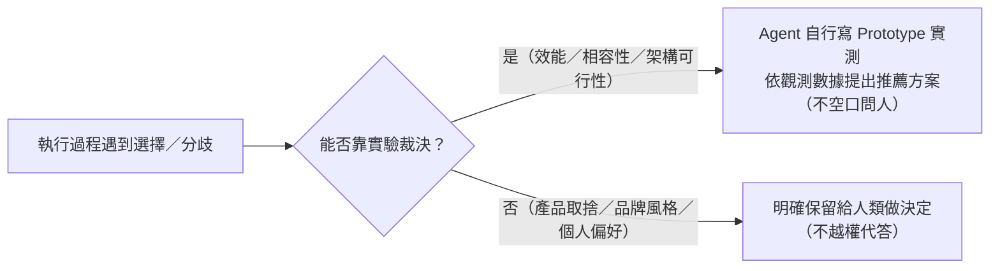

# pstack `/sharpen` 原始碼深度拆解：把任務做深、不做大

- 來源：https://github.com/cursor/plugins/blob/main/pstack/skills/sharpen/SKILL.md 、https://github.com/cursor/plugins/blob/main/pstack/docs/guide/02-poteto-mode.md 、https://github.com/cursor/plugins/blob/main/pstack/docs/guide/10-recipes-and-pitfalls.md
- 收錄日期：2026-11-25
- 與本專案的關聯：pstack `/sharpen` skill 的原始碼與設計機制拆解筆記，屬學習筆記，與 OpenWiki 程式碼無直接關聯
- 備註：依據本地同步之 `cursor/plugins`（2026-11-20 快照）`pstack/skills/sharpen/SKILL.md` 全文（16 行）整理；搭配影片筆記 [pstack-video-deep-dive.md](./pstack-video-deep-dive.md) 閱讀可對照口述與原始碼差異。

## 核心定位

`sharpen` 全文僅 **16 行**，卻承載了 pstack 前置輸入治理的核心哲學：**「Make a task deeper, not bigger, then rewrite the prompt.」**

它的定位非常克制——**只改寫 prompt、不執行任務**，且在改寫後把新 prompt 交還人類確認，確認無誤才送進 `/poteto-mode` 或其他工作流。

## 原始碼結構逐段拆解

### 1. Frontmatter 護欄（L1–L5）

```yaml
---
name: sharpen
description: "Make a task deeper, not bigger, then rewrite the prompt. Use for /sharpen."
disable-model-invocation: true
---
```

- **`disable-model-invocation: true`**：刻意禁止模型自行判斷觸發，只能由使用者顯式輸入 `/sharpen`。
  - **設計原因**：`/sharpen` 的契約是「不執行任務、只回傳改寫後的 prompt」。若允許模型自動叫用，可能在使用者真正要動工時意外中斷執行鏈，或陷入反覆改寫 prompt 的迴圈。

### 2. 改寫前必做的四件事（L7–L14）

原文開門見山鎖死約束：**「I want a deeper version of this task, not a bigger one.」**（範圍守恆，禁止擴張 scope），並要求模型在重寫前先顯式回答四個問題：

| # | 原文要點 | 解決的常見失敗模式 |
|---|---|---|
| 1 | **專家隱性標準**：頂尖專業者在這裡會做、但我沒要求的事 | 使用者不知道自己漏提哪些關鍵步驟（unknown unknowns），導致產出停在初階水準 |
| 2 | **最原始第一手材料（rawest material）**：專家會從哪份源頭資料起手，而不是別人消化過的摘要 | 防止 AI 只讀過時 README、二手文件或聊天摘要，逼它直讀原始碼、schema、log、spec 等真源 |
| 3 | **具體方法與工具**：該領域專家會用什麼工具與方法執行 | 把空泛動詞（「優化」「寫好」「檢查」）釘死成可重複的工程方法與專業工具（如 profiler、benchmark、AST 檢查） |
| 4 | **第三方客觀驗收（`other than you or me`）**：除了 AI 與人類之外，什麼外部機制能證明結果是對的 | 直接剔除「AI 自稱改好了」與「人類肉眼覺得不錯」兩種主觀驗收，強制引入測試、CI、實測指標、瀏覽器錄影等外部真值 |

完成上述四項分析後（L14）：`Then rewrite my prompt to ask for exactly that.` —— 將四項具體結論壓回重寫後的 prompt，確保「分析」與「新指令」1:1 對應，不另起爐灶加戲。

### 3. 決策權切分公式（L16，影片未提的隱藏核心）

> *"Have the rewritten prompt ask the agent to prototype any choice an experiment can settle and recommend an option based on what it observed. Leave product or preference choices that no experiment can settle for me to make."*

這句是 `/sharpen` 與一般「prompt 優化器」拉開差距的關鍵。它把後續執行階段會遇到的所有分歧切成兩類，各自規定行為：



- **可實驗問題不打擾人類**：與 pstack 整體「能自查自測就不問人」原則一致，消滅低價值的來回確認。
- **偏好問題不越權代答**：防止 AI 在需求模糊時擅自替產品拍板，把人類注意力集中在真正需要主觀判斷的決策點。

## 與影片口述（`05:10–06:28`）的精確對照

| 項目 | 影片口述（Gary Chen） | 官方 `SKILL.md` 實況 |
|---|---|---|
| 結構條數 | 歸納為 3 點（把工具方法與客觀驗證併成第 3 點） | 明確拆成 **4 點**，第 4 點特別強調 `other than you or me`（排除雙方主觀判斷） |
| 決策權切分 | 未於 `/sharpen` 段落提及（改在後段 Matt 對比章節零星帶到） | 直接內建在 `SKILL.md` 最後一段，強制寫進改寫後的 prompt |
| 觸發保護 | 未提 frontmatter 機制 | 明確設定 `disable-model-invocation: true`，確保只改寫不偷跑 |

## 在 pstack 工作流中的位置與搭配

根據官方指南 [02-poteto-mode.md](https://github.com/cursor/plugins/blob/main/pstack/docs/guide/02-poteto-mode.md)，動工前有兩個互補的輕量前置 skill：

| 場景 | 使用指令 | 作用 |
|---|---|---|
| 輸入雜訊太多（長討論串、模糊客訴） | `/in-your-own-words` | 讓 AI 用白話重述核心問題與目標，在寫任何程式碼前抓出誤讀 |
| 目標大致清楚，但不確定問得夠不夠深、夠不夠專業 | `/sharpen <草稿 prompt>` | 做深不做大，補齊專家步驟、第一手源頭、專業工具、外部驗收與實驗／偏好切分 |

典型兩步用法（官方手冊範例）：

```text
# Step 1：先銳化（只回傳新 prompt，不動手）
/sharpen write a migration guide for the v2 config format.

# Step 2：人類審閱新 prompt 確認無誤後，再交給總管執行
/poteto-mode <貼上或確認執行改寫後的 prompt>
```

## 借鏡與落地要點

1. **短而硬的元提示（Meta-Prompt）設計**：僅 16 行、沒有冗長角色扮演，靠四個強制槽位＋一條範圍守恆約束＋一條決策邊界規則，就能穩定產出高品質任務規格。
2. **「deeper, not bigger」可單獨移植**：即使不用整套 pstack，將這 4 個問題＋決策切分句抽成個人快捷指令，即可直接改善 Claude Code / OpenCode / Cursor 的前期需求對齊品質。
3. **不適用於純探索性腦力激盪**：如果你連方向都還沒定（0→1 產品發想），應先用訪談式工具（如 `grill-me`）釐清偏好，再交 `/sharpen` 壓深執行規格。

## 相關資源

- 官方原始碼：https://github.com/cursor/plugins/blob/main/pstack/skills/sharpen/SKILL.md
- 本 repo 相關筆記：
  - [pstack-core-skills-deep-dive.md](./pstack-core-skills-deep-dive.md) — `/architect`、`/arena`、`/interrogate`、`/swarm`、`/correct`、`/show-me-your-work` 官方原始碼拆解與七大 skill 總覽表
  - [pstack-video-deep-dive.md](./pstack-video-deep-dive.md) — pstack 完整工作流影片拆解（含 `05:52` 段落）
  - [pstack-opencode-install.md](./pstack-opencode-install.md) — pstack 在 opencode CLI 上的安裝與限制
  - [pstack-teaching-decks.md](./pstack-teaching-decks.md) — pstack 教學簡報與心得頁索引
