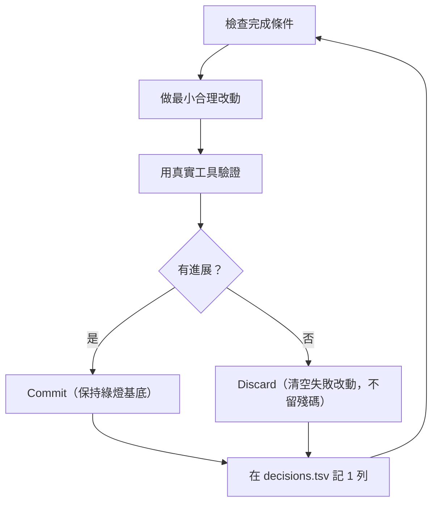

# pstack 基本使用方法、日常流程與實戰範例指南

- 來源：https://github.com/cursor/plugins/blob/main/pstack/docs/guide/01-setup.md 、https://github.com/cursor/plugins/blob/main/pstack/docs/guide/02-poteto-mode.md 、https://github.com/cursor/plugins/blob/main/pstack/docs/guide/06-verify-and-ship.md 、https://github.com/cursor/plugins/blob/main/pstack/docs/guide/07-overnight.md 、https://github.com/cursor/plugins/blob/main/pstack/skills/create-verification-skill/SKILL.md
- 收錄日期：2026-11-26
- 與本專案的關聯：pstack 實務操作教學與常用 Prompt 範本筆記，屬學習筆記，與 OpenWiki 程式碼無直接關聯
- 備註：整理自 `cursor/plugins`（2026-11-20 快照）官方指南與對話實戰範例；各核心 skill 原始碼細節請搭配 [pstack-core-skills-deep-dive.md](./pstack-core-skills-deep-dive.md) 與 [pstack-sharpen-deep-dive.md](./pstack-sharpen-deep-dive.md) 閱讀。

## 核心心智模型

把 `pstack` 想成**一家餐廳的廚房**：

- **58+ 個 skill** 是廚房裡的各式工具與 SOP（平底鍋、溫度計、出菜試吃表），平常不需要自己逐一手動操作。
- **`/poteto-mode`** 是**主廚（總管路由器）**：你對他下單（講清目標、完成條件、要看什麼證據），主廚自動匹配 22 本任務劇本（playbooks）的對應一本，把步驟填入 TodoList，依序呼叫需要的 skill 上場。

---

## 安裝與一次性初始化

### 各平台安裝與前綴差異

| 平台 | 安裝方式 | 呼叫方式範例 | 備註 |
|---|---|---|---|
| **Cursor** | 對話輸入 `/add-plugin pstack` | `/setup-pstack`、`/poteto-mode` | 支援 Custom Mode（`Option+Enter` / `Alt+Enter`）與 `/loop` |
| **Claude Code** | `/plugin marketplace add cursor/plugins` → `/plugin install pstack@cursor-plugins` | `/pstack:setup-pstack`、`/pstack:poteto-mode` | 規則寫入 `~/.claude/rules/pstack-models.md` |
| **OpenCode** | 複製 `skills/` 至 `~/.config/opencode/skills/pstack/` | `@poteto-mode` | 詳見 [pstack-opencode-install.md](./pstack-opencode-install.md)（無 `/loop`） |

### 初始化必跑 `/setup-pstack`

1. 偵測目前可用模型，讓你挑選推理預算（`small` / `medium` / `large`）與各角色對應模型（體力活交便宜快模型、深度思考交前沿模型；設為 `auto` 或 `inherit-parent` 則沿用主對話模型）。
2. 寫入模型規則檔（Cursor 為 `~/.cursor/rules/pstack-models.mdc`）。
3. 詢問是否替專案生成 `verify-<app>`（`/create-verification-skill`）——**強烈建議選 Yes**，讓 AI 學會像真人一樣啟動與驗證你的 App。
4. 設定完成後**開啟新對話**，模型規則才會生效。

---

## 日常開發 4 步流程


### 寫好 `/poteto-mode` Prompt 的「黃金 5 要素」

不需要寫長篇規格書，每個要素各一句即可：

1. **目標（Goal）**：說清壞在哪或要新增什麼（刻意**不寫死解法**、**不先塞猜測的根因**）。
2. **已知線索（Context）**：症狀、job ID、錯誤 log、相關連結，幫 AI 省去盲搜。
3. **硬約束（Constraints）**：例如 `repro first`、`don't change any code yet`、`zero behavior change`、`let me review before proceeding`。
4. **可判定完成條件（Done Check）**：非黑即白能判定 Pass / Fail，禁止「改好一點」「跑快一點」。
5. **驗證證據（Proof）**：指定想看的真實輸出（測試指令輸出、修改前後數據、操作錄影或截圖）。

> **兩樣刻意不要寫進 Prompt 的東西**：① 實作細節（留空間讓 agent 找更好做法）；② 自己猜的原因（先讓 AI 查證，避免錨定偏誤）。

---

## 5 大實戰場景範例

### 範例 1｜修 Bug（推薦第一個練的場景）

```text
/poteto-mode the csv export drops its last row since yesterday's deploy.
failing job id is 4812.
repro first, then fix.
done means the 60k-row fixture exports every row.
show me the row counts before and after.
```

- **劇本路由**：匹配 **Bug fix**（`repro first` 強制先重現才准改碼）。
- **驗證重點**：不聽口頭宣稱修好了，直接核對前後行數輸出。

### 範例 2｜先查清根因、絕不動手改碼（唯讀調查 → 再切修復）

情境：API 偶爾回 500、手邊只有 200 行錯誤 log，想先看懂問題再決定修法。

```text
# 第一輪：鎖定 Investigation（唯讀調查）劇本
/poteto-mode 這支 GET /api/orders 偶爾回 500（附下方 200 行 log）。
先用你自己的話重述錯誤發生的情境，再查出真正的根因與觸發條件。
先不要改任何程式碼（don't change any code yet）。
完成條件：指出確切的檔案與行號、完整的觸發路徑，並附上對應的程式碼或重現指令當證據。

<貼上 200 行 log>
```

- **關鍵煞車**：`don't change any code yet` 會把路由鎖死在 **Investigation** 劇本，避免 AI 一看到「壞掉」就跳進 Bug fix 直接改檔。
- **第二輪切進修復**（看完根因報告後，在同對話直接續接）：
  ```text
  /poteto-mode 確認是這個根因了，請先寫重現測試再修復，完成後跑完整測試給我輸出。
  ```

### 範例 3｜做新功能（附設計審查煞車）

```text
/poteto-mode 我們要幫外部 webhook 加上 rate limiting。
先用 /architect 定好結構，有不確定的技術選項用 prototype 實測給我比較。
動手寫正式程式前先停下來讓我 review。
```

- 確認設計無誤後，直接回覆 `continue` 或 `/poteto-mode do it` 即可進入實作。
- **同一對話換主題時**：務必加上 `new task`（例：`/poteto-mode new task. 查為什麼登出後快取還在，先別改任何程式。`），否則會被當成上一個功能的延伸步驟。

### 範例 4｜需求還很模糊（先 `/sharpen` 銳化再進總管）

```text
# Step 1：只改寫 prompt、絕不動手執行
/sharpen 幫這個查詢頁跑快一點，現在資料一多就會卡

# Step 2：審閱改寫後的 prompt 確認方向與驗收指標無誤，再交給總管開工
/poteto-mode <貼上確認後的 prompt>
```

### 範例 5｜安全重構（鎖死行為零變動）

```text
/poteto-mode 把 src/billing/ 裡分散的 3 種收款檢查收斂成單一 validator。
約束：zero behavior change（既有行為與錯誤碼必須完全一致）。
完成條件：所有 billing 單元測試與整合測試全綠，舊的重複函式全數刪除。
驗證證據：貼上重構前後的測試輸出與 diff 摘要。
```

---

## 過夜自動化（Overnight Run）與隔早審計

### 過夜合約 5 要素模板

```text
/poteto-mode im going to bed.
migrate every caller to the new parser in a fresh worktree off main.
done means zero old callers, all parser fixtures pass, old api deleted.
keep a decision log. don't ask me before committing.
/loop until done. if you're truly stuck after a few hours, stop and write up why.
```

| 子句 | 提供的工程保護 |
|---|---|
| `im going to bed` | 會話覆寫訊號：不中斷問人，持續推進 |
| `in a fresh worktree off main` | **物理隔離**：開獨立 worktree 保護白天未提交草稿；跑偏時一行 `git worktree remove` 歸零 |
| `done means ...` | 每輪迴圈機器可判定的結束條件，避免提早宣稱完工 |
| `keep a decision log` | 啟用 `/show-me-your-work` 寫入 Append-only TSV 決策帳本 |
| `don't ask me before committing` | 預先授權 commit（不含 merge / deploy / 刪資料） |
| `/loop until done` | Cursor 內建喚醒機制（OpenCode 不支援 `/loop`，改以單次長執行） |
| `if truly stuck ... stop and write up why` | **停損逃生門**：卡死時停機寫明原因，防止 AI 放寬標準或刪測試硬過關 |

### 為什麼沒進展的迭代要直接 Discard（丟棄）？



- **Git 工作區只留綠燈狀態**：避免半殘嘗試留下奇怪寫法，導致下一輪 AI 照抄疊補丁（錯誤複利＋上下文污染）。
- **`decisions.tsv` 負責保存試錯記憶**：失敗原因記在帳本裡，下一輪從乾淨的綠燈 commit 換路重試，不重複踩同一個坑。

### 隔早驗收與多任務 Autopilot 選擇

| 指令／模式 | 適用時機 | 行為重點 |
|---|---|---|
| `/ketchup` | 30 秒快速看進度 | 唯讀摘要改動內容、附截圖／小圖表，列出待你拍板的決定與風險 |
| `/show-me-your-work catch me up on what you did last night` | 嚴格審計過夜任務 | 讀 TSV＋逐字稿並派**異廠模型**標出 `Attention` 風險列，只抽查被標記處 |
| **Autopilot-stack**（預設推薦） | 多項獨立任務排隊，保留人工合併 | `/poteto-mode autopilot these five changes, but don't merge. i'll land them in the morning.` |
| **Autopilot-full**（高信任後再開） | 多項獨立任務全自動驗證並合併 | `/poteto-mode full autopilot on this queue. each item is independent. i want them merged by morning.`（寫碼者無權自審，須獨立 `/swarm` 全過才 merge） |

---

## 替自己專案建立驗證技能：`/create-verification-skill`

「編譯過了」不是證據。讓 AI 自己能像真人一樣啟動、操作並截圖／錄影驗證你的 App，是整套 pstack 投資報酬率最高的一步。只要在專案裡跑一次：

```text
/create-verification-skill
```

它會「**先面試程式碼庫，不先煩使用者**」，針對你的 repo 產出一套專案專屬的 `.cursor/skills/verify-<app>/`（設計給「從沒看過專案、冷啟動的新 agent」直接照跑）。

### 產出物的 5 個固定步驟與必備規格

| 步驟 | 執行內容 | 關鍵防呆要求（來自官方 `SKILL.md`） |
|---|---|---|
| **1. 面試 repo** | 從程式碼自動判讀 5 件事：`Surface`（Web/CLI/TUI/API/Mobile）、`Run`（啟動／port／env／seed／auth）、`Drive`（優先沿用 Playwright/Cypress/PTY/curl）、`Observe`（截圖／log／DB 狀態）、`Isolate`（能否雙開） | 只問程式碼看不出的事；若無法安全雙開，必須明寫「拒絕同時驅動共享實例」，絕不弄壞使用者會話 |
| **2. 生成 `SKILL.md`** | 產出 `.cursor/skills/verify-<app>/SKILL.md`，含 6 區段：`Launch`、`Doctor`、`Drive`、`Evidence`、`Cleanup`、`Helpers` | ① `Launch` 必須從空資料夾＋migration＋seed 跑到「真正可用（usable）」而非只看 process 起來<br>② `Drive` 用真實 repo 的穩定 handle（ARIA／`data-*`／route），禁座標與 Tab 順序<br>③ `Cleanup` 只殺自己起的 PID（禁按名稱亂殺），且**絕不可把證據檔一起刪掉** |
| **3. 建立 Feature Map** | 建立 `features/README.md` 與 Top 3–5 使用者功能的各別說明檔（固定 4 個 H2：`Sub-features`、`How to get to it`、`Driving it`、`Gotchas`） | 若 seed 資料缺前置條件，須直接報失敗並記進 `Gotchas`，**嚴禁為讓測試過關而弱化旅程** |
| **4. 端到端自證一次** | 交件前實際跑完整條鏈：`Launch → Doctor → 驅動 1 個功能 → 留存 Evidence → Cleanup` | **未實際跑過的驗證技能只是草稿，不算交付物**；清理完必須複核證據檔仍在指定路徑 |
| **5. 持續維護** | 隨 App 改版定期跑 `/maintain-verification-skill`（建議排程每日跑一次） | 僅回報 `clean` / `changed` / `blocked`，絕不偷改產品碼；抓到產品回歸直接報錯，不靠改文件遮掩 |

### 建好後的日常實戰用法

把 `.cursor/skills/verify-<app>/` commit 進 repo 當作團隊共用基礎設施後，就可以直接在指令裡點名驗收方式：

```text
# 做新功能並附錄影截圖證據
/poteto-mode build the bulk-archive action. use /verify-<app> to verify your changes and show me a video and screenshots as proof.

# 先在主線重現 Bug，確認可重現再修並附影片
/poteto-mode repro this with /verify-<app>. if it repros on main, fix it and show me a video as proof.
```

> 進階搭法：當 `features/` 地圖建好後，就能交給 `/swarm` 按功能清單切片平行實機驗收，用來在大改版或過夜合併前做全覆蓋回歸檢查。

---

## 初學者最常踩的 4 個坑（Common Mistakes）

| 錯誤做法 | 根因（為什麼會壞） | 正確做法 |
|---|---|---|
| 在 Prompt 手動點名一整串 skill（先 `/how` 再 `/architect` 再 `/arena`…） | playbook 已排好順序與升級條件；手寫常打亂或漏驗證，還白燒 token | 只寫目標＋5 要素，把調度交給 `/poteto-mode`；只在要覆寫強度時單點一個 skill |
| 一開始把猜測根因寫進 Prompt | 觸發錨定偏誤，AI 直接順著錯誤假設亂改 | 只給現象與 log，加 `repro first` 或 `don't change any code yet` |
| 改錯字、換顏色這種小改動也開 `/poteto-mode` | 啟動子代理與多步驗證，慢又貴 | 小改動直接一般對話；跨邊界、高風險、需自證的工作才進 `/poteto-mode` |
| 捨不得丟棄失敗改動，叫 AI 在髒工作區繼續修 | 沉沒成本謬誤，壞程式碼會污染後續所有迭代上下文 | 驗證失敗且方向存疑時果斷 Discard 回上一個綠燈 commit，記錄原因換路 |

---

## 相關筆記

- [pstack-video-deep-dive.md](./pstack-video-deep-dive.md) — pstack 完整工作流影片拆解與架構圖
- [pstack-sharpen-deep-dive.md](./pstack-sharpen-deep-dive.md) — `/sharpen` 官方 16 行原始碼拆解
- [pstack-core-skills-deep-dive.md](./pstack-core-skills-deep-dive.md) — 七大核心 Skill 原始碼拆解與總覽對照表
- [pstack-opencode-install.md](./pstack-opencode-install.md) — pstack 在 opencode CLI 上的安裝與限制實測
- [pstack-teaching-decks.md](./pstack-teaching-decks.md) — pstack 離線教學簡報與心得頁索引
