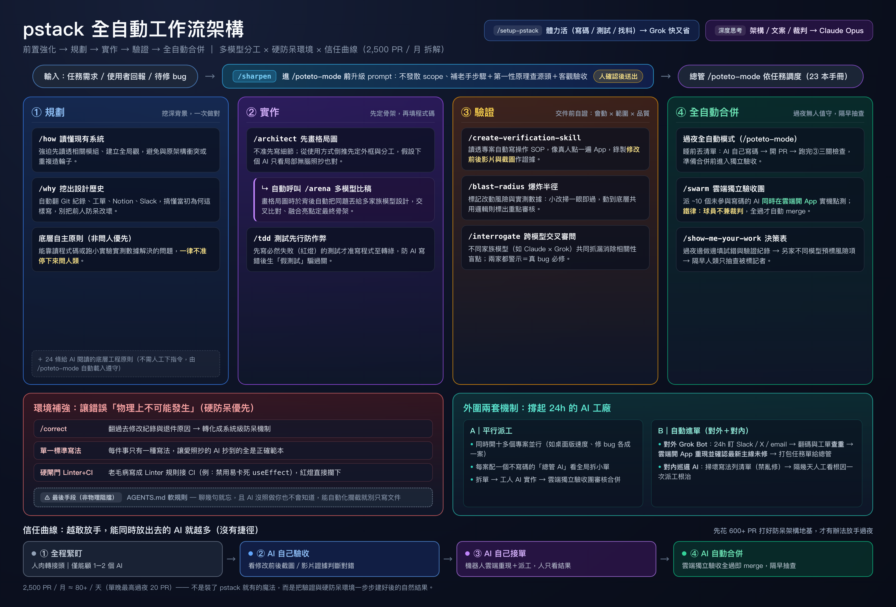

# pstack 深度拆解！怎麼讓 AI 全自動完成你的工作？（影片筆記）

- 來源：https://www.youtube.com/watch?v=l_xDqUm0MDQ
- 收錄日期：2026-11-25
- 與本專案的關聯：pstack／agentic coding 工作流的影片內容整理，屬學習筆記，與 OpenWiki 程式碼無直接關聯
- 影片資訊：頻道 Gary Chen｜長度 26:39（1599s）｜上傳 2026-10-31
- 素材來源：官方章節（yt-dlp `chapters`）＋ zh-TW 字幕逐字稿；時間戳以官方為準
- 備註：內容為講者引述 Lauren Tan（poteto）演講與其開源 pstack 之整理，非本機實測。「單月 2,500 張 PR」屬講者引述之對外宣稱（待外部佐證，與文中「80+/天」內部一致）；另影片口述之「近 60 個 skill、23 本手冊」為 2026-10-31 當時口徑，與本 repo 實測快照（58–59 個技能、22 本劇本）略有版本演進差異，詳見同目錄實測筆記。

## 📌 影片摘要

本片拆解 SpaceX AI 工程師 Lauren Tan（poteto）開源的 **pstack**：一套近 60 個 skill 的 agentic coding 工作流，讓她單月合併約 2,500 張 PR（≈80+/天，甚至單晚過夜自動合併 20 張 PR）。核心論點是——當 AI 寫程式已不再是瓶頸，真正的瓶頸轉移到「驗證」；pstack 透過「前置強化與模型路由 → 規劃 → 實作 → 驗證 → 全自動合併 → 環境補強」整套流水線，把人類從逐行把關退到事後抽查。產量不是魔法，而是**信任曲線**逐階爬升、驗證與防呆環境打好後的自然結果。

## ⏱️ 影片目錄與時間戳記（來源：官方章節）

- [00:00] 一個月 2500 張 PR：以 Lauren 的產量與過夜 20 張 PR 破題，定義 PR＝結案報告
- [01:01] Lauren 是誰：Netflix / Meta / Cursor → SpaceX Grok Bot，高標準資深工程師
- [01:56] pstack 安裝與設定：丟 GitHub 連結安裝、`/setup-pstack` 依角色分配模型、`/poteto-mode` 總管調度
- [03:44] 規劃：`/how`、`/why`、`/sharpen` 先把系統與歷史挖深、升級 prompt 再動手
- [06:28] 實作：`/architect`（背後自動叫 `/arena`）與 `/tdd` 先畫骨架、多模型比稿、測試先行
- [08:06] 驗證：三道關卡對應人類審 PR 的三個焦慮
- [11:31] 睡覺時自動合併：`/poteto-mode` 全自動模式、`/swarm` 獨立驗收團、`/show-me-your-work` 決策紀錄表
- [13:28] 補強環境：`/correct` + 單一寫法 + Linter/CI 硬閘門，取代 AGENTS.md 軟規則
- [15:53] 平行派工與自動進單：總管 AI 拆單、Grok Bot 24h 接單重現、巡邏 AI 集中根因治理
- [18:11] 信任曲線：從「人肉轉接頭」開始的四階爬升，600+ PR 打地基，無捷徑
- [20:24] pstack 對比 Matt：動工後多模型自動驗證 vs 動工前對齊＋合併前把關
- [22:48] 一般人的六步清單：從單一 AI 觀察失敗到開啟自動合併，建出自己的工作流

## 💡 核心重點與案例列表

- **核心觀點 1｜瓶頸已從「生成」轉移到「驗證」**
  - **影片舉例**：Lauren 一天 80+ 張 PR，甚至一覺醒來已有 20 張 PR 在夜間由 AI 完成、檢查並合併；就算只用人眼逐張檢查，時間也絕對不夠，卡點是「你敢不敢讓 AI 寫的 code 正式上線」。
  - **深入解析**：當寫程式成本趨近零，工程價值轉為 **verification（如何讓 agent 自證產出）**。解題只有兩條路：①大幅加快人工審核速度；②把人工審核從合併前移走但仍確保不出包。驗證能力直接決定並行上限。

- **核心觀點 2｜pstack 結構與 `/setup-pstack` 模型路由：不拿同一模型包辦所有事**
  - **影片舉例**：近 60 個 skill 分為 **24 個給 AI 讀的底層工程原則**（人不需操作）與 **30 幾個工具型 skill**；平常只需記總管指令 `/poteto-mode`，內建 **23 本任務標準作業手冊**，依修 bug／新功能／改效能自動調度對應 skill。安裝後先跑 `/setup-pstack` 偵測可用模型並依角色分工：寫碼、跑測試、分頭找資料等體力活交給便宜又快的 **Grok**；架構設計、寫文案、當裁判下判斷等深度思考才交給 **Claude Opus** 這類前沿模型。
  - **深入解析**：把「工程規範」從人工記憶下沉為 AI 自動讀取的原則與劇本，再用角色級 Model Routing 壓低高並行時的 token 成本，是整套流水線能規模化的基礎。

- **核心觀點 3｜三階段流水線：先求「一次做對」，再談自動化**
  - **影片舉例**：`/poteto-mode` 作為「工地主任」，把任務拆成前期規劃（`/how`、`/why`）→ 中期實作（`/architect`、`/arena`、`/tdd`）→ 後期驗證（三道關卡）。
  - **深入解析**：與一般 Plan Mode 最大差異在「動手前把背景挖深」。Plan Mode 只掃附近檔案就開工，容易與原架構衝突或重造輪子；前段先降返工，後段驗證才撐得住吞吐量。

- **核心觀點 4｜`/how` + `/why`：把「不懂脈絡就亂改」這個最大返工來源前移消滅**
  - **影片舉例**：`/how` 強迫 AI 讀透相關模組建立全局觀；`/why` 自動翻 Git 修改紀錄、工單、Notion、Slack，找出「當初為何這樣寫」。
  - **深入解析**：程式碼只顯示結果、不顯示歷史；看似繞的寫法往往是前人踩坑後的防呆。AI 不知歷史 → 自作聰明改掉 → 舊 bug 復發。

- **核心觀點 5｜`/sharpen`（`05:10–06:28`）：送進 `/poteto-mode` 前的「範圍守恆」升級與人機確認閘門**
  - **影片舉例**：**在把任務交給 `/poteto-mode` 之前**先跑 `/sharpen`，把模糊一句話（如「幫我讓這個網頁跑快一點」）從頂尖專家視角重寫為含明確驗收條件的專業 prompt，並**交還人類確認無誤後才送出**。
  - **三大重構維度（`05:46–06:17`）**：
    1. **補齊專家隱性步驟**：若是領域頂尖老手接單，有哪些他一定會做、但原始需求漏提的關鍵步驟？
    2. **第一性原理查證**：要求 AI 做判斷時直接查最底層的原始碼或**第一手源頭資訊**，不依賴已消化、可能過時失真的二手文件。
    3. **鎖定專業工具與客觀驗收**：明確鎖定該領域專業人士使用的具體工具與方法，以及最後用什麼客觀證據證明真的做對。
  - **深入解析**：一般請 AI「優化 prompt」最常犯的毛病是亂加周邊功能、把 scope 越搞越大；`/sharpen` 的核心是**不發散需求（範圍守恆）、往深處做透（深度提升）**，再透過人類確認鎖死目標才進入自動執行。

- **核心觀點 6｜`/architect`（自動呼叫 `/arena`）+ `/tdd`：先定防呆骨架、多模型比稿、紅燈防作弊**
  - **影片舉例**：`/architect` 規定先不准寫實作細節，要**從使用者未來如何操作倒推**，先定系統外框與分工；它預設「下一個接手的 AI 只看眼前一個檔案、照抄最近例子、走最省力捷徑」。畫格局圖時，`/architect` 會在背後**自動呼叫 `/arena`**，把同題丟給不同家族模型各自設計再融合亮點。真正動手寫碼時強制 `/tdd`，先寫必然失敗（紅燈）的測試才准寫實作，直到轉綠。
  - **深入解析**：把 AI 的惰性轉成架構約束——好架構要讓**局部無腦照抄也對**；多模型比稿抵銷單一模型的設計偏誤；紅燈先行則是防作弊機制，避免 AI 先寫錯程式後再補「配合錯誤邏輯的假測試」交差。

- **核心觀點 7｜驗證三道關卡＝回答人類審 PR 的三個焦慮**
  - **影片舉例**：①「真的會動嗎」→ `/create-verification-skill`（讀透專案自動寫操作 SOP，像真人一樣開啟 App 點一遍並錄影截圖）；②「影響多大」→ `/blast-radius`（標記爆炸半徑與風險高低，小改掃一眼、動到底層共用邏輯則重點審）；③「品質好不好」→ `/interrogate`（跨模型交叉抓漏）。
  - **深入解析**：當 PR 送到人面前時，已附帶**修改前後的操作影片**與**爆炸半徑實測數據**，程式碼也被多模型洗過一輪；不需拉下來本機跑，審核從分鐘級降到「幾十秒看敘述＋影片就能核准」。

- **核心觀點 8｜跨模型盲點論：同一個模型換角色，盲點一模一樣**
  - **影片舉例**：`/interrogate` 把改好的程式碼同時丟給不同家族模型（如 Claude 與 Grok）抓漏，兩家異口同聲警示＝絕非誤判、交件前必修；隔早審查過夜紀錄前，同樣派另一家不同模型先核對風險。
  - **深入解析**：「請你扮演資深專家」≠ 獨立性。同一模型換再多角色仍會漏掉相同死角，必須換**模型家族**才能消除相關性盲點（correlated blind spots）；代價是 token 消耗顯著提高，預算緊者須審慎評估。

- **核心觀點 9｜過夜全自動合併鐵律：球員不兼裁判＋雲端獨立驗收＋事後抽樣**
  - **影片舉例**：`/poteto-mode` 的過夜全自動模式中，AI 自行寫碼、開 PR、跑完三關檢查後，準備合併前由系統呼叫 `/swarm`，派出約 **10 個從頭到尾沒參與寫碼的獨立驗收 AI，同時在雲端打開 App** 像真人一樣到處點測；寫 PR 的 AI 永遠無權核准自己，唯有獨立裁判全數通過才自動 merge。整個過程 AI 同步執行 `/show-me-your-work`，**邊做邊填決策紀錄表**（試錯退回、最終改法與驗證方式），隔早交給 Lauren 前先由另一家模型標記驗證薄弱或高風險項，她醒來只需針對標記做抽查與環境補強。
  - **深入解析**：拿掉「合併前人類點頭」後，用「執行者與裁判分離＋雲端隔離實測＋可追溯決策表＋跨模型預標記＋事後抽樣」替代事前把關——風險控制由 gate 轉為 audit。

- **核心觀點 10｜環境補強 > 軟規則（最關鍵洞見）**
  - **影片舉例**：多數人遇錯就往 prompt 或 `AGENTS.md` 加規定，但軟規則聊幾句就忘，而且 AI 沒照做你也無從得知；Lauren 用 `/correct` 翻過去修改紀錄與退件原因，轉成兩類系統防呆：①**單一標準寫法**（讓愛照抄的 AI 抄到的全是正確範本）；②把老毛病寫成 **Linter 規則接 CI 硬閘門**（例如前端 React 寫 `useEffect` 易造成畫面卡死，直接用 Linter 禁用、CI 亮紅燈逼 AI 改掉）。`AGENTS.md` 只當最後萬不得已的手段。
  - **深入解析**：硬閘門讓錯誤「物理上不可能發生」。環境改造成「想寫錯都很難」後的副作用驚人：連不懂深度開發的 PM 與設計師都能自己叫 AI 改功能送 PR，而且看一眼就能核准。

- **核心觀點 11｜規模化靠外圍兩套：平行派工 + 自動進單**
  - **影片舉例**：
    - **平行派工**：同時開十多個專案，每案配一個不寫碼的「總管 AI」看全局拆單 → 工人 AI 寫碼 → 獨立驗收團審核合併。
    - **對外自動進單**：Grok Bot 24h 盯 Slack／X／email 模糊抱怨，先翻程式碼與工單**查重（確認是否已報過）**，再直接**在雲端打開 App 重現並確認最新主線還沒修掉**，最後把問題定位、重現步驟與壞掉截圖打包成標準任務單送給總管 AI。
    - **對內巡邏**：巡邏 AI 每天掃描壞寫法但不准私自亂修，先記成清單；隔幾天人工一檢，常發現十個問題其實源於同一個根因，再交總管 AI 一次性根治。
  - **深入解析**：2,500 PR 不是「一個 AI 很快」，而是**工廠化**（進單＋派工＋驗收三條產線）。講者也點出，現今許多團隊不再跑 Scrum、改由運營／行銷直接私訊工程師提需求，這種自動進單機制正好能化解高頻零碎需求的瓶頸。

- **核心觀點 12｜信任曲線四階：產量是信任的結果**
  - **影片舉例**：①全程緊盯（她在 Cursor 第一週救上線功能時當「人肉轉接頭」，頂多顧 1–2 個 AI）→②AI 自己驗收（看截圖與影片證據判斷）→③AI 自己接單（機器人重現＋派工，人看結果）→④AI 自動合併（獨立驗收全過即 merge，隔早抽查與補環境）。她光打防呆架構地基就先花了 **600+ 張 PR**，第一晚放手過夜時仍超怕把系統弄垮。
  - **深入解析**：只要人類還卡在中間幫 AI 轉述畫面與錯誤，就永遠無法並行。地基沒打好就一次開十幾個 AI ＝ **十倍速度產垃圾＋白燒 token**。

- **核心觀點 13｜pstack vs Matt：兩種哲學選型，可互補**
  - **影片舉例**：
    - **Matt（Matt Pocock 的 skill）**：重心在**動工前人機對齊**（`grill-me` 密集追問 → `to-spec` → 任務卡）＋**合併前人類把關**（`/pr` 整理證據），單模型、重視 context 狀態、token 消耗低，且新手在「不懂就問」過程中有學習成長空間。
    - **pstack（Lauren Tan）**：重心壓低人類介入，**硬規定只要 AI 能自己讀碼查清楚或寫小版本實測數據比較，就一律不准停下來問人類**；資源全砸在動工後多模型自動驗收與獨立實機測，高 token、把人推到事後抽查。
  - **深入解析**：0→1 需求模糊（只有你知道自己要什麼）→ Matt；已有龐大歷史程式碼、大量修 bug／重構／改效能（重點是不能改壞）→ pstack。正如 **Lauren 本人在 X 上所說**，兩套可完美互補：前期先用 Matt 想清楚規格，再交 pstack 嚴格驗證落地；新手建議先從 Matt 起步。

## 🖼️ 核心架構與流程圖

架構圖涵蓋：輸入與前置 `/sharpen` 人機確認 → ①規劃／②實作（含 `/architect` 自動呼叫 `/arena`）／③驗證／④全自動合併（含過夜 `/show-me-your-work` 決策紀錄＋跨模型預審）四段流水線、硬防呆環境補強（並與最後手段 `AGENTS.md` 軟規則明確區隔）、外圍兩套工廠機制、信任曲線四階，以及模型路由（Grok 體力活／Claude Opus 深度思考）。

## 🚀 結論、操作指南與未來展望

**本質總結**：pstack 的價值不在某個神奇 skill，而在「**驗證即瓶頸**」的認知重構——用前置強化與規劃降低返工、用多模型與獨立驗收替代人工把關、用硬閘門讓錯誤物理上不可能發生，最後才敢把人類退到事後抽查。2,500 PR 是這套體系成熟後的副產品，不是起點。

### pstack 流程對照表

| 階段 | 核心 skill | 解決的問題 | 對應人類焦慮／角色 |
|---|---|---|---|
| 初始化 | `/setup-pstack` `/poteto-mode` | 模型成本與能力分工、23 本手冊自動調度 | 不必背 60 個指令、控成本 |
| 前置強化 | `/sharpen`（進總管前，人確認） | prompt 模糊、優化時亂發散 scope | 需求沒說清做偏方向 |
| 規劃 | `/how` `/why` | 不懂全局與歷史防呆就亂改 | 會不會改壞舊防呆／重造輪子 |
| 實作 | `/architect`（自動叫 `/arena`） `/tdd` | 架構偏誤、局部照抄出錯、假測試作弊 | 設計對不對、測試真假 |
| 驗證 | `/create-verification-skill` `/blast-radius` `/interrogate` | 功能會動？影響範圍？品質漏洞？ | 審 PR 的三個焦慮 |
| 全自動 | `/swarm`（雲端獨立測）＋自動合併＋`/show-me-your-work` | 拿掉人工合併後的安全與過夜可追溯性 | 沒人點頭敢上線嗎 |
| 環境 | `/correct` + 單一寫法 + Linter/CI | AI 反覆犯同錯（`AGENTS.md` 僅最後手段） | 如何從物理層根治 |

### Lauren 給一般人的六步導入清單（每步有過關標準）

1. **只裝一個 AI，觀察它怎麼失敗**：先不急著裝任何大禮包（包含 pstack）；記下每次開口糾正它的話，能清楚講出它最常犯的三種錯誤才進下一步。
2. **把糾正變成規則**：寫進 `CLAUDE.md` 等每次必讀檔；凡是能用系統檢查或 hook 自動攔截的，絕不只寫在文件裡。同錯不再出現第二次＝過關。
3. **交件必須附證據**（最關鍵）：不准只聽口頭說「做好了」；做網頁就叫它自己開瀏覽器點一遍截圖，整理資料就叫它列出核對過哪幾筆、怎麼核對的。你能不開檔案、光看證據判斷對錯＝練成。
4. **同時開 2–3 個 AI，做與審分開**：寫的 AI 交出成果與證據後，派**另一個不同模型**挑過一輪毛病，最後你親自合併。同時顧三個仍從容且多數不需重做＝過關。
5. **睡前交代任務，但停在合併前**：完成條件要「非黑即白」可判定（「改好看點」不行；「手機不用左右滑、每顆按鈕都點得到」才行），並設**停損點**（卡住太久就停下來**寫出原因**）；只准存檔與開 PR，合併／發布／刪資料／對外發訊等難挽回動作一律留給隔早人類。
6. **連續幾早醒來 PR 都免收拾，才開自動合併**：獨立驗收全過即自動 merge，你隔早只做抽樣檢查；並可排程讓 AI 巡信箱／表單／工作群組自動接單重現並修復。

> 前四步是最花時間也最值得投資的基本功。按部就班走完，最終得到的不是 `pstack` 或 `grill-me`，而是**屬於你自己的工作流**。

### 成本與落地限制（落地必讀）

- **Token 成本高**：`/arena` 比稿、`/interrogate` 多模型交叉審問、`/swarm` 十餘個 AI 雲端實機驗收，是「用錢換正確率」，預算緊者慎用。
- **基礎設施門檻高**：`/swarm` 與 Grok Bot 自動重現都預設具備可由 AI 同時啟動 App 的**雲端測試／預覽環境**，純本機開發難以直接照搬。
- **不可跳級並行**：驗證與防呆環境未建好就開十餘個 AI，只會十倍速產垃圾並白燒 token。
- **相關性盲點**：同一模型換角色無效，審查與核對必須切換**不同模型家族**才有效。

**未來趨勢與可能進展**：影片描繪的「軟體工廠」形態——需求自動進單、總管 AI 拆派、獨立驗收團把關、人類退居抽查與環境治理——預示工程師角色將從「寫程式」轉為「設計驗證機制與防呆環境」。隨著模型變便宜、雲端沙盒與驗證工具標準化，這類流水線會逐步下放，但「信任曲線」決定了導入速度無法跳級。

## 🔗 相關資源與關鍵字

- **官方與外部資源**：
  - pstack 官方開源目錄（影片僅提名稱未附連結）：https://github.com/cursor/plugins/tree/main/pstack
  - Matt Pocock 的 skill 套件（影片中對比之 `grill-me`、`to-spec`、`pr` 等工作流，由 Matt Pocock 發布）
  - 講者 Skool 社群（含 Matt／Lauren 混搭指南與六步自評提示詞）：https://www.skool.com/gary-chen
- **本 repo 相關筆記**：
  - [pstack-sharpen-deep-dive.md](./pstack-sharpen-deep-dive.md) — `/sharpen` 官方 16 行原始碼逐段拆解與影片口述差異對照
  - [pstack-core-skills-deep-dive.md](./pstack-core-skills-deep-dive.md) — `/architect`、`/arena`、`/interrogate`、`/swarm`、`/correct`、`/show-me-your-work` 官方原始碼拆解與七大 skill 總覽表
  - [pstack-opencode-install.md](./pstack-opencode-install.md) — pstack 在 opencode CLI 的實際安裝、ID 衝突解法與 Cursor 專屬限制實測（58 skills / 22 playbooks 快照）
  - [pstack-teaching-decks.md](./pstack-teaching-decks.md) — pstack 官方文件與指南的離線教學簡報索引（59 子目錄快照）
- **核心關鍵字**：Agentic Coding、Verification、Multi-Model Review（跨模型審查）、Model Routing（模型路由）、Test-Driven Development（TDD）、Blast Radius（爆炸半徑）、Context Engineering、AI Software Factory（AI 軟體工廠）、Trust Curve（信任曲線）。
